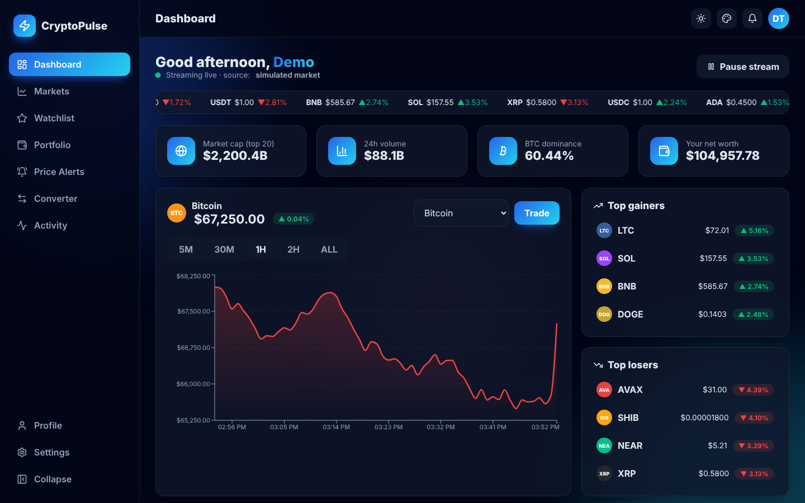
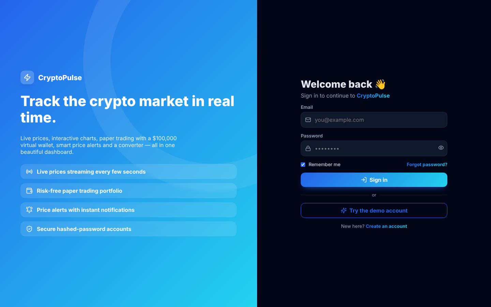
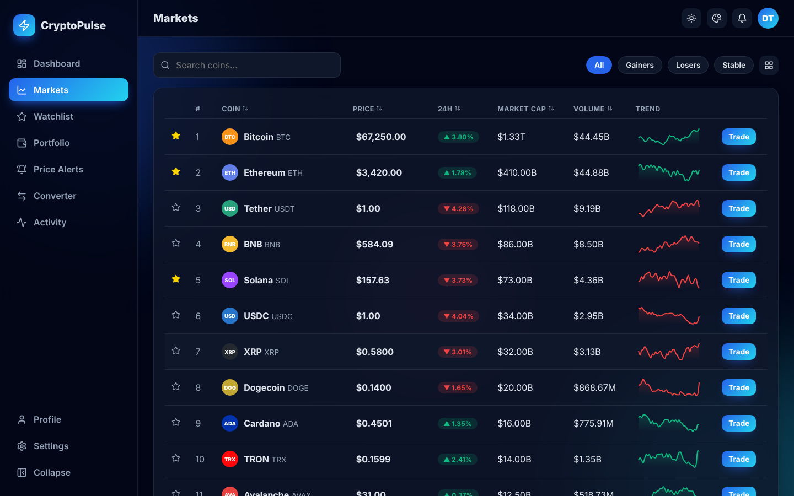
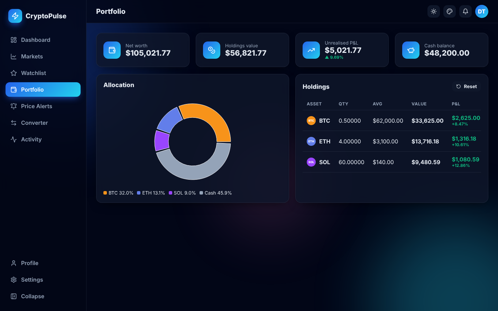

<div align="center">

# ⚡ CryptoPulse

### Real-time cryptocurrency market dashboard with paper trading, price alerts & multi-theme UI


</div>



## ✨ Features

| Area | What you get |
|---|---|
| 🔐 **Auth** | Register & login pages, SHA-256 salted password hashing (Web Crypto), password-strength meter, remember-me, demo account, protected routes, change password, delete account |
| 📈 **Live market** | 20 top coins synced from the **CoinGecko API** every 60 s, plus a real-time tick engine every 2.5 s — prices flash green/red on each tick; pause/resume stream |
| 🖥️ **Dashboard** | Scrolling ticker tape, animated count-up KPIs (market cap, volume, BTC dominance, net worth), interactive price chart with 5M/30M/1H/2H/ALL ranges, top gainers & losers |
| 🔎 **Markets** | Search, filters (gainers / losers / stablecoins), sortable columns, sparklines, table ⇄ card grid view |
| ⭐ **Watchlist** | Star any coin; personal watchlist per user |
| 💼 **Paper trading** | $100,000 virtual wallet, buy/sell in USD or coin units, 25/50/75/100 % quick-fill, average cost, unrealised P&L, allocation donut chart, wallet reset |
| 🔔 **Price alerts** | Above/below targets with ±% presets — notifications fire the moment a live price crosses |
| 💱 **Converter** | Crypto ⇄ crypto ⇄ fiat (USD, EUR, GBP, INR, JPY, AED), updates live |
| 🧾 **Activity** | Full trade history with filters and **CSV export** |
| 🎨 **Themes** | Light, Dark, Midnight, Sepia & System modes · 6 accent gradients · corner-radius slider · compact mode · animations toggle |
| 🎞️ **Animations** | Floating gradient blobs, page transitions, staggered cards, shimmer buttons, pop-in modals, slide-in toasts, pulsing live indicators |
| 📱 **Responsive** | Collapsible sidebar, mobile drawer navigation |

## 🖼️ Screenshots

| Login | Markets | Portfolio |
|---|---|---|
|  |  |  |

## 🚀 Getting started

```bash
git clone https://github.com/PreciousBharath/CRYPTOPULSE-REALTIME-CRYPTO-DASHBOARD.git
cd CRYPTOPULSE-REALTIME-CRYPTO-DASHBOARD
npm install
npm run dev
```

Open http://localhost:5173 and click **Try the demo account** (`demo@cryptopulse.app` / `Demo@1234`) or register a new account.

## 🧱 Project structure

```
src/
├── main.jsx            # Providers: Router, Theme, Toast, Auth
├── App.jsx             # Routes + protected layout
├── auth.jsx            # Register/login, hashed passwords, sessions
├── theme.jsx           # Theme modes, accents, preferences
├── market.jsx          # CoinGecko sync + real-time tick engine
├── wallet.jsx          # Paper trading, watchlist, alert engine
├── components/         # Layout, ThemePanel, PriceChart, TradeModal, StatCard…
└── pages/              # Dashboard, Markets, Portfolio, Alerts, Converter, Activity, Login, Register…
```

## 🛠️ Tech stack

React 18 · React Router 6 · Recharts · Lucide icons · Vite · CSS variables & keyframe animations · Web Crypto API · localStorage (per-user data isolation)

> ⚠️ Paper trading only — no real money is involved. Market data from CoinGecko's public API; when it is unreachable or rate-limited the app falls back to a realistic simulated market.

## 📄 License

MIT © [Bharath](https://github.com/PreciousBharath)
